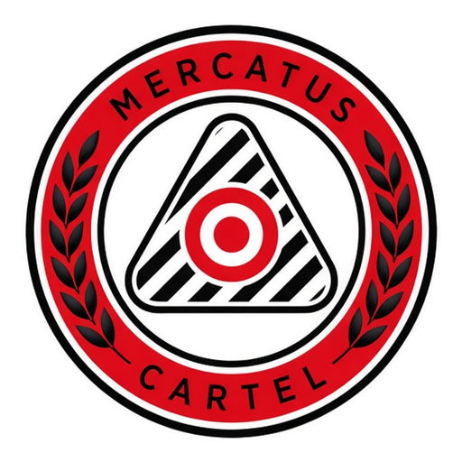
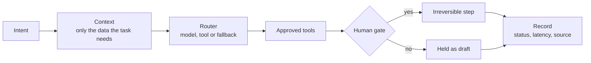

  

<h1 align="center">Mens Mercatus — Portfolio</h1>

  AI agents and LLM automation for SMEs up to enterprise, for clients globally. 
  <a href="https://mensmercatus.online">mensmercatus.online</a> ·
  <a href="https://mensmercatus.online/services/">Services</a> ·
  <a href="https://mensmercatus.online/case-studies/">Case studies</a>

---

Mens Mercatus is the AI agents and LLM automation practice of **Katlego Mokoto**, an AI engineer and systems architect working in .NET/C#, React and Python. The systems here do the slow, repetitive work — sorting, retrieving, ranking, drafting — and stop for a human yes before anything irreversible happens. This repository is a **public showcase**: what each app does, how it is built, its limits, live links and screenshots. It contains **no source code and no secrets**; the source is private and available in a code walkthrough on request.

## Apps

| App | Status | What it is | Live |
|---|---|---|---|
| [Mercatus Assist](apps/mercatus-assist/) | LIVE + labelled DEMO | AI assistant that answers from the site's own pages and cites its sources | [Open](https://mensmercatus.online/apps/mercatus-assist/) |
| [THINK](apps/think/) | LIVE, capped | Gemini multimodal workspace: chat, image and live voice, key kept on the server | [Open](https://mensmercatus.online/think/) |
| [JobNet Application](apps/jobnet/) | Public: drafts only · Private: capped gated send | Career pipeline: shortlist, match and tailored drafts on the public demo; private pipeline may send only with a printed verified employer address and quality checks | [Open](https://mensmercatus.online/apps/jobnet/) |
| [Forex Mercatus Codex](apps/forex-codex/) | Paper only | Research terminal and session-scoped paper bot, built so it can't be mistaken for a brokerage | [Open](https://mensmercatus.online/apps/forex-codex/) |
| [SoundX AI](apps/soundx-ai/) | Browser demo | Beat studio in a browser tab with on-device AI tools; audio stays on the machine | [Open](https://mensmercatus.online/apps/soundx-ai/) |
| [Mercatus Concierge](apps/mercatus-concierge/) | DEMO · guide shell | A guided route through the desks, with honest status for each one | [Open](https://mensmercatus.online/apps/mercatus-concierge/) |

Smaller builds and explainers on the site: [Event Net](https://mensmercatus.online/apps/event-net/) (DEMO, in-browser simulation of one event shift), [NET Gemini workspace](https://mensmercatus.online/apps/net-workspace/) (static explainer with sample request/response JSON) and the [Labs](https://mensmercatus.online/labs/) page.

## Principles

Every system in this portfolio follows the same rules:

1. **A human yes on irreversible steps.** Sends, payments, refunds, applications and orders wait for a named person by default. Agents prepare, recommend and flag; people decide.
2. **Drafts on the public JobNet demo; gated sends only in the private pipeline.** The public JobNet page is drafts-only and never auto-applies. Separately, the private server pipeline may send a capped letter only when the posting prints a verified employer address and the letter passes quality checks; otherwise the send is held. Do not read the private system as “never sending.”
3. **Keys stay server-side.** Model calls go through a same-origin proxy to a C# / ASP.NET Core service. The browser never receives a provider key.
4. **Caps and a labelled demo mode.** Per-IP daily caps on public AI paths, exponential backoff on 429/5xx, and a visible DEMO state when the live path is unhealthy — live and demo are never the same state.
5. **Honest scope.** Paper is labelled paper, demo is labelled demo, and limits are written down on every app page.

## Stack at a glance

C# · ASP.NET Core 8 · React 19 · TypeScript · Vite · Python · Gemini (OpenAI-compatible client) · MiniLM / BM25 retrieval · Web Audio · nginx · systemd · Ubuntu VPS · Cloudflare

## Contact

- Website: [mensmercatus.online](https://mensmercatus.online) · [Services](https://mensmercatus.online/services/)
- Email: katlego.mokoto.km@gmail.com
- LinkedIn: [linkedin.com/in/katlego-mokoto1759](https://www.linkedin.com/in/katlego-mokoto1759/)
- Instagram: [@mensmercatus](https://www.instagram.com/mensmercatus/)

Available for freelance builds, contract and permanent roles — Johannesburg, Pretoria, Cape Town, Durban or remote worldwide.

## License

Documentation and text in this repository: [CC BY-NC 4.0](LICENSE). Screenshots, the Mercatus Cartel badge and the Mens Mercatus name: all rights reserved. See [LICENSE](LICENSE).
