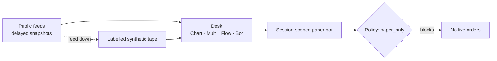
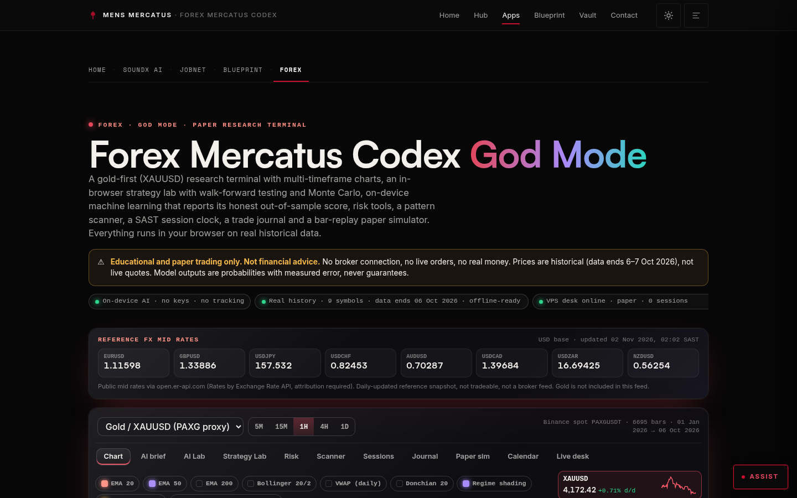
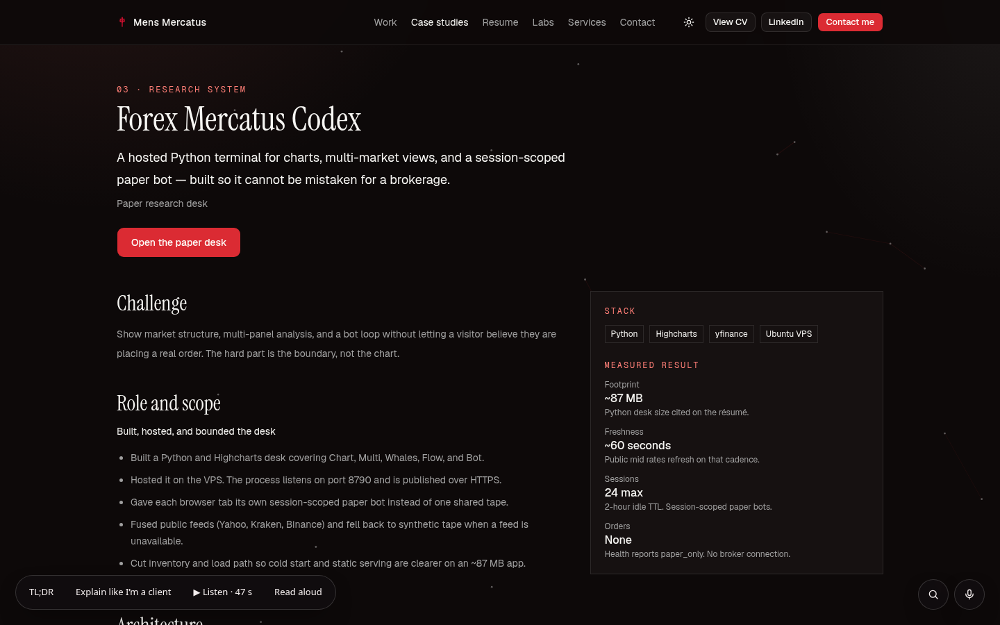

# Forex Mercatus Codex

**Status:** PAPER ONLY — not a brokerage, not advice · **Live:** https://mensmercatus.online/apps/forex-codex/ · **Case study:** https://mensmercatus.online/case-studies/forex/

## What it does
A market-research terminal built so it cannot be mistaken for a brokerage. The hard part is the boundary, not the chart.

- **God Mode (in-browser):** a gold-first (XAUUSD) research terminal with multi-timeframe charts, a strategy lab with walk-forward testing and Monte Carlo, on-device machine learning that reports its honest out-of-sample score, risk tools, a pattern scanner, a SAST session clock, a trade journal and a bar-replay paper simulator, on historical data.
- **Hosted paper desk:** a Python and Highcharts desk covering Chart, Multi, Whales, Flow and Bot, with one session-scoped paper bot per browser tab.

## How it's built
- Python desk on an Ubuntu VPS, published over HTTPS.
- Public feeds fused (e.g. Yahoo, Kraken, Binance), with **labelled** synthetic tape when a feed is unavailable.
- One paper bot per browser tab; capped concurrent sessions with an idle timeout.
- A public health JSON reports `paper_only`, symbols, data sources, the session cap and the idle TTL.
- Policy gate: no broker credentials, no order route; sign-in and journal edits are off on the public desk.

## Limits
- Simulated research only: not a brokerage, not an exchange, not financial advice. No real money.
- Quotes are delayed public snapshots; God Mode uses historical data, not live quotes.
- Model outputs are probabilities with measured error, never guarantees.
- Charts use Highcharts for the portfolio demo.

## Screenshots
| God Mode desk | Case study |
|---|---|
|  |  |
