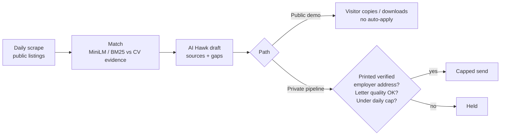
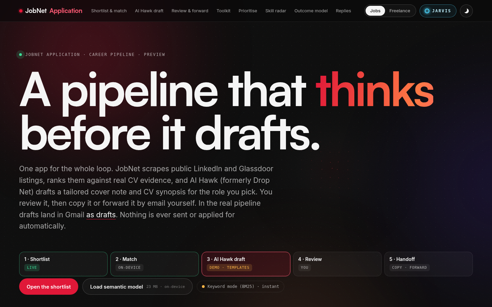

# JobNet Application

**Status:** Public demo — drafts only / no auto-apply · Private pipeline — capped send when a printed employer address verifies and the letter passes quality checks · **Live (public demo):** https://mensmercatus.online/apps/jobnet/ · **Case study:** https://mensmercatus.online/case-studies/jobnet/

## What it does
A career pipeline that turns public job posts into a ranked shortlist and tailored application drafts. Applying by hand is slow and auto-apply bots are unsafe, so JobNet shortens the research and drafting loop without giving the public demo permission to apply or send mail.

1. **Shortlist** — a scheduled daily scrape of public listings, published as a read-only shortlist.
2. **Match** — sentence embeddings (MiniLM, self-hosted, in a background worker) compare each requirement with real CV evidence; BM25 keyword mode takes over instantly when the model isn't loaded. One role per company.
3. **AI Hawk draft** — a cover note and CV synopsis for one role, built only from facts on the published CV and case studies. Anything it can't back up stays a `[placeholder]` or is listed as a gap.
4. **Review** — a person checks every claim and placeholder.
5. **Handoff (public demo)** — copy, download or forward the text yourself. The public page never auto-applies and never sends mail.

**Private server pipeline (separate from the public demo):** a capped send is allowed only when the posting prints a verified employer address and the letter passes quality checks. Otherwise the send is held. The private system is not described as “never sending”; it sends only through that gate.

## How it's built
- Scheduled collection (daily) of public listings — read-only on the public page.
- On-device ranking with MiniLM embeddings and a BM25 fallback on the public demo.
- Drafting from CV and case-study context, with sources and explicit gaps.
- Public demo output stays on-device / drafts for the visitor to handle.
- Private pipeline: quality-gated, address-verified, capped outbound only when those checks pass.
- On the public page, AI Hawk runs from templates on the visitor's device: no LLM call, nothing stored or sent.

## Limits
- A personal operating system for a job search, not a multi-tenant product.
- Draft quality depends on the source posting and the résumé context.
- The public page is a drafts-only demo; visitors cannot trigger applications or mail.
- Automated tests live with the private source.

## Screenshots

