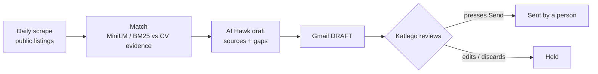

# JobNet Application

**Status:** DRAFTS ONLY — never auto-applies, never auto-sends · **Live (public, read-only demo):** https://mensmercatus.online/apps/jobnet/ · **Case study:** https://mensmercatus.online/case-studies/jobnet/

## What it does
A career pipeline that turns public job posts into a ranked shortlist and tailored application drafts. Applying by hand is slow and auto-apply bots are unsafe, so JobNet shortens the research and drafting loop without ever being given permission to apply or send mail.

1. **Shortlist** — a scheduled daily scrape of public listings, published as a read-only shortlist.
2. **Match** — sentence embeddings (MiniLM, self-hosted, in a background worker) compare each requirement with real CV evidence; BM25 keyword mode takes over instantly when the model isn't loaded. One role per company.
3. **AI Hawk draft** — a cover note and CV synopsis for one role, built only from facts on the published CV and case studies. Anything it can't back up stays a `[placeholder]` or is listed as a gap.
4. **Review** — a person checks every claim and placeholder.
5. **Handoff** — copy, download or forward the text yourself.

**In the real pipeline, every email lands in Gmail as a draft. Katlego reviews it and presses Send himself. Nothing is ever sent or applied for automatically.**

## How it's built
- Scheduled collection (daily) of public listings — read-only.
- On-device ranking with MiniLM embeddings and a BM25 fallback.
- Drafting from CV and case-study context, with sources and explicit gaps.
- Gmail drafts as the only output of the private pipeline; sending is outside the agent's permissions.
- On the public page, AI Hawk runs from templates on the visitor's device: no LLM call, nothing stored or sent.

## Limits
- A personal operating system for a job search, not a multi-tenant product.
- Draft quality depends on the source posting and the résumé context.
- The public page is a read-only demo; visitors cannot trigger applications or mail.
- Automated tests live with the private source.

## Screenshots

