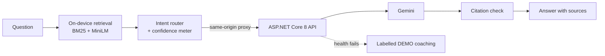
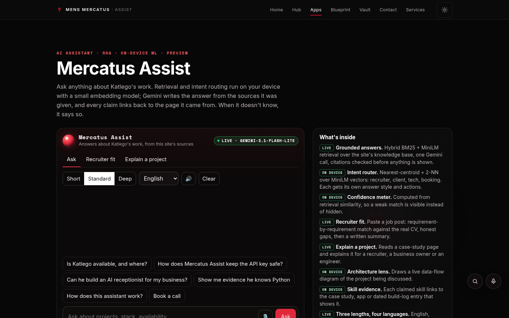
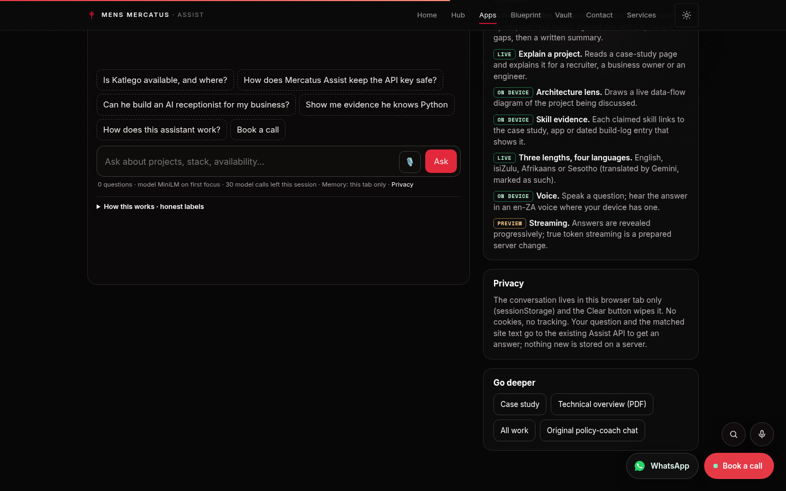
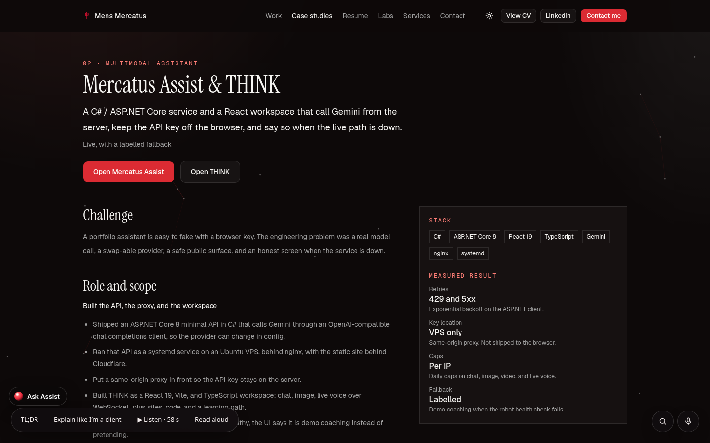
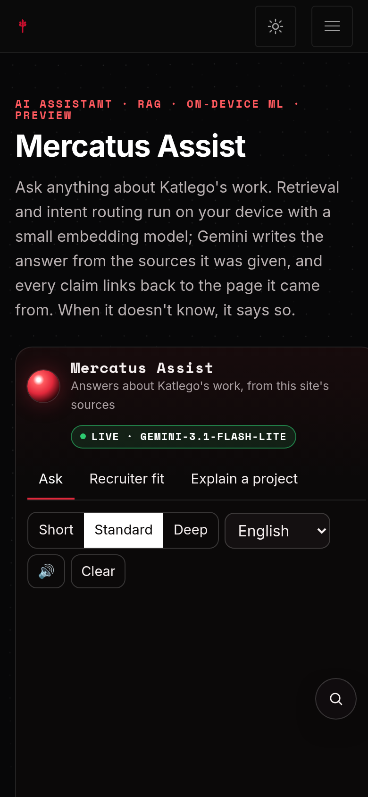

# Mercatus Assist

**Status:** LIVE, with a labelled DEMO fallback · **Live:** https://mensmercatus.online/apps/mercatus-assist/ · **Case study:** https://mensmercatus.online/case-studies/assist/

## What it does
An AI assistant that answers questions about Katlego Mokoto's work from the site's own pages, with every claim linked back to its source. When it doesn't know, it says so.

- **Grounded answers:** hybrid BM25 + MiniLM retrieval over the site's knowledge base, one Gemini call, citations checked before anything is shown.
- **Intent router (on device):** nearest-centroid + 2-NN over MiniLM vectors — recruiter, client, tech, booking — each with its own answer style.
- **Confidence meter (on device):** computed from retrieval similarity, so a weak match is visible instead of hidden.
- **Recruiter fit:** paste a job post for a requirement-by-requirement match against the real CV, honest gaps included.
- **Explain a project** for a recruiter, a business owner or an engineer.
- **Three lengths, four languages:** English, isiZulu, Afrikaans or Sesotho (translated by Gemini and marked as such).
- **Voice:** speak a question; hear the answer in an en-ZA voice where the device has one.

## How it's built
- Retrieval, intent routing and the confidence meter run in the browser with a small embedding model.
- A C# / ASP.NET Core 8 API calls Gemini server-side through a same-origin proxy, so the key never reaches the browser.
- Exponential backoff on 429 and 5xx, per-IP caps, and a labelled DEMO state when the model is busy or down — the chat never dead-ends.

## Privacy
The conversation stays in the browser tab (sessionStorage) and Clear wipes it. No cookies, no tracking. The question and matched site text go to the Assist API to get an answer; nothing new is stored on a server.

## Limits
- Answers only about the portfolio's own content; it is not a general-purpose assistant.
- Streaming is progressive reveal; true token streaming is a prepared server change.
- Translations are machine translations by Gemini and are marked as such.

## Screenshots
| Assist | Features |
|---|---|
|  |  |
| **Case study** | **Mobile** |
|  |  |
