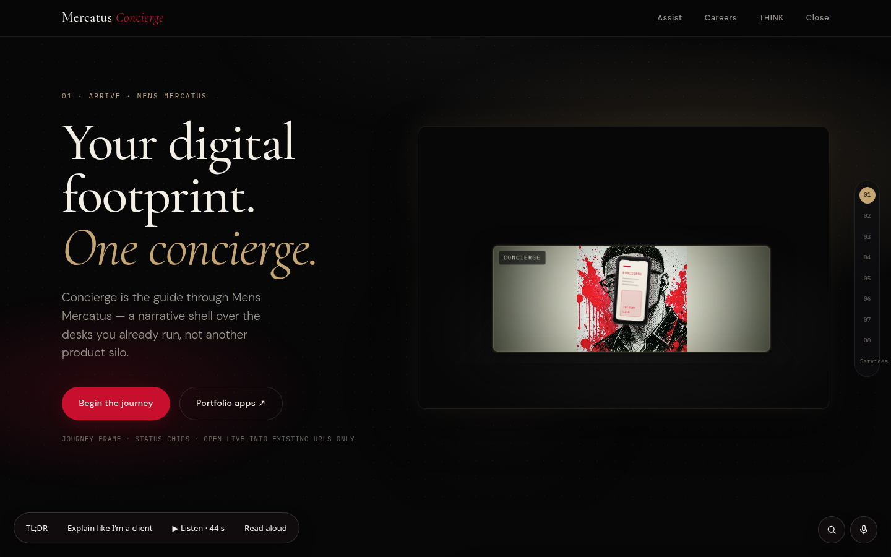

# Mercatus Concierge

**Status:** DEMO · guide shell — no payments, no sign-in · **Live:** https://mensmercatus.online/apps/mercatus-concierge/

## What it does
A guided route through the Mens Mercatus desks: a brief builder, a "First Look" and an honest score. It points visitors at each system (JobNet, Forex Codex, SoundX AI, THINK, Assist) and shows its real status — paper, demo, draft-only or local — rather than a fake green "up" light.

## How it's built
- A static guide shell on the portfolio site that links into the live apps.
- Status checks show "Checking…" until a desk answers; local-only tools (such as the private Mercatus Lab) are named as local, not presented as public URLs.

## Limits
- A navigation and briefing shell, not a booking or payment system.
- No sign-in and no payments; nothing is submitted on a visitor's behalf.

## Screenshots

