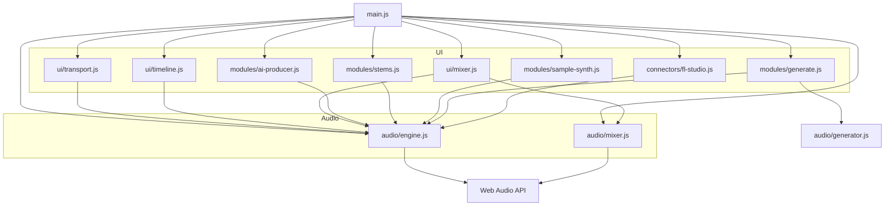
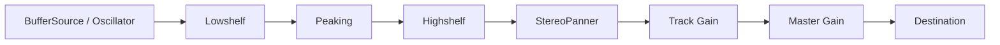

# Architecture — Mens Mercatus Sound Deck

Static ES-module app. No backend required for the MVP.

## Layout

```
left: Library | center: Timeline | right: AI / connectors | bottom: Mixer
top: Transport | footer: Status
```

## Module diagram



## Audio graph (per track)



## Responsibilities

| Module | Role |
|--------|------|
| `audio/engine.js` | Context, transport clock, tracks/clips, scheduling, demo buffers, project JSON |
| `audio/mixer.js` | Optional convolver stub / FX state |
| `ui/transport.js` | Transport chrome, save/load/export |
| `ui/timeline.js` | Track lanes, clips, drag/drop from library |
| `ui/mixer.js` | Channel strips bound to engine params |
| `modules/ai-producer.js` | Local regex/intent replies |
| `modules/stems.js` | OfflineAudioContext band split |
| `modules/sample-synth.js` | Prompt → recipe → buffer library |
| `modules/generate.js` | Text-to-music / stems / continuation (Web Audio) |
| `audio/generator.js` | Scales, drum patterns, phrase helpers |
| `connectors/fl-studio.js` | User file/folder decode → library |

## Project state

Serialized via `engine.toJSON()` / `fromJSON()`:

- BPM, loop, metronome  
- Tracks: name, type, mute/solo, volume, pan, EQ  
- Clips: timing, color, `recipe` / `notes` (AudioBuffers rebuilt on load)

Persisted to `localStorage` key `mm-sound-deck-project` or downloaded as `.json`.


## Additional panels (MVP+)

| Module | Role |
|--------|------|
| `modules/ai-producer.js` | Local order-taking assistant |
| `modules/stems.js` | Demo DSP band split |
| `modules/beats.js` | 16-step sequencer → clips |
| `modules/mic.js` | getUserMedia record |
| `modules/vocals.js` | Vocal record + FX bounce |
| `modules/vst-rack.js` | Insert slot UI + bridge client |
| `connectors/fl-studio.js` | User pack import |
| `connectors/vst-bridge-client.js` | Bridge probe/load |
| `modules/generate.js` | In-house Generate panel |
| `audio/generator.js` | Shared synthesis helpers |
| `connectors/suno.js` | Removed stub (no UI) |
