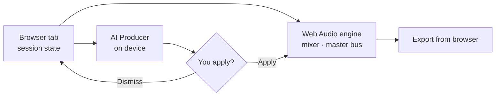
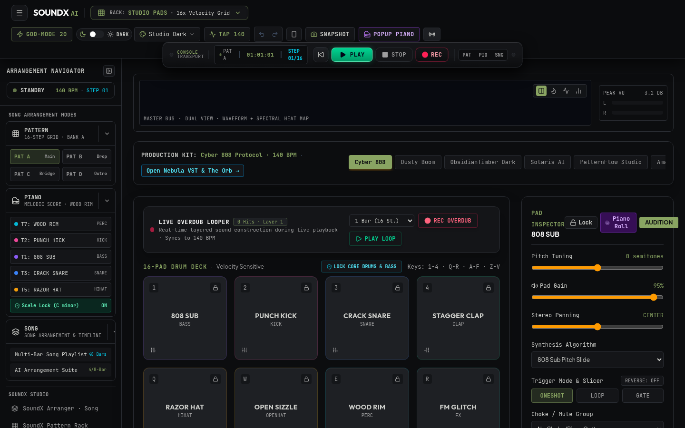
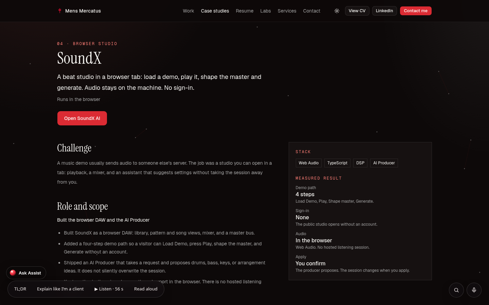

# SoundX AI

**Status:** Browser demo — no sign-in, no upload · **Live:** https://mensmercatus.online/apps/soundx-ai/ · **Case study:** https://mensmercatus.online/case-studies/soundx/

## What it does
An AI drum station and beat studio that opens in a browser tab: library, pattern and song views, mixer, master bus, a plugin rack, Afro sample packs and themes, plus on-device AI tools such as tempo and key detection, hum-to-MIDI, clash-fixing EQ and Mix QA. An AI Producer proposes drums, bass, keys or arrangement ideas from a written request — and the session changes only when you apply it.

## How it's built
- TypeScript front end with Web Audio for playback, stems, the mixer and the master EQ/reverb path.
- AI tools run on device; audio stays on the machine. There is no hosted listening session.
- The AI Producer proposes and explains; Apply and Dismiss stay with the person.
- Export from the browser; the microphone is optional and asks for permission.

## Limits
- A browser demo, not a hosted DAW with saved cloud projects.
- Sound quality and export depend on the browser's Web Audio support.
- No server health endpoint; the check is local (Play makes sound, the demo path advances).

## Screenshots
| Studio | Case study |
|---|---|
|  |  |
