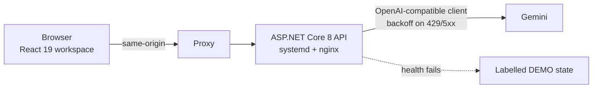
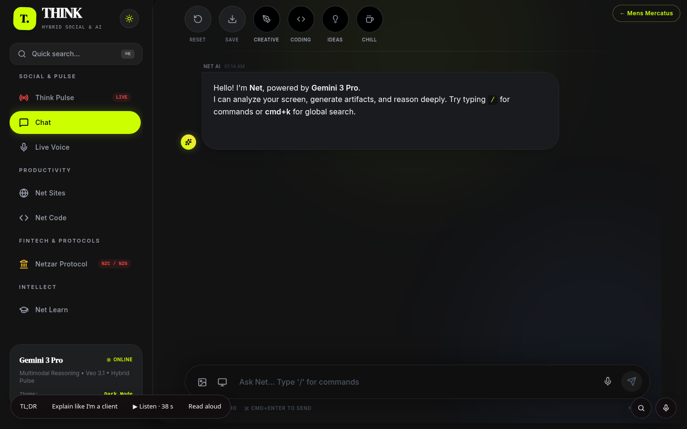
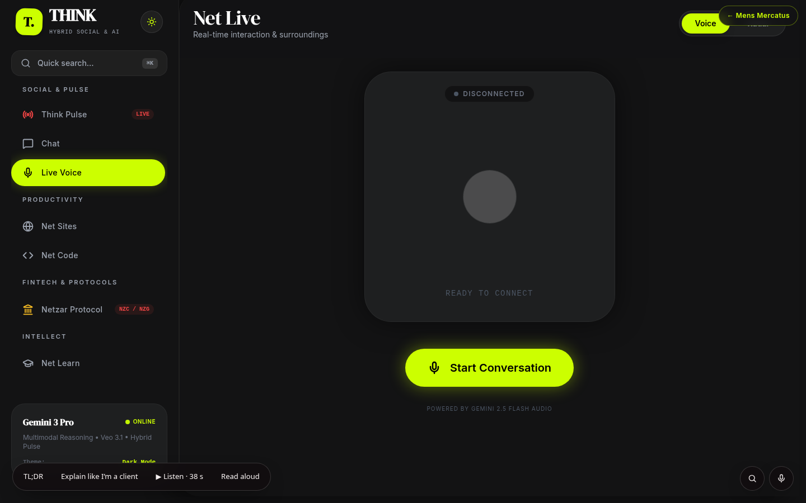
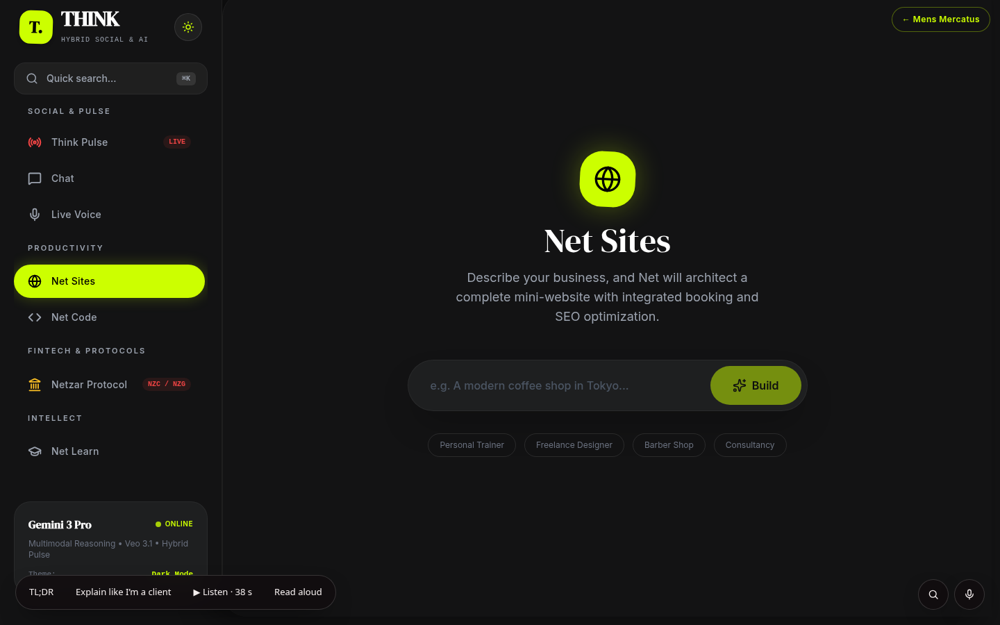
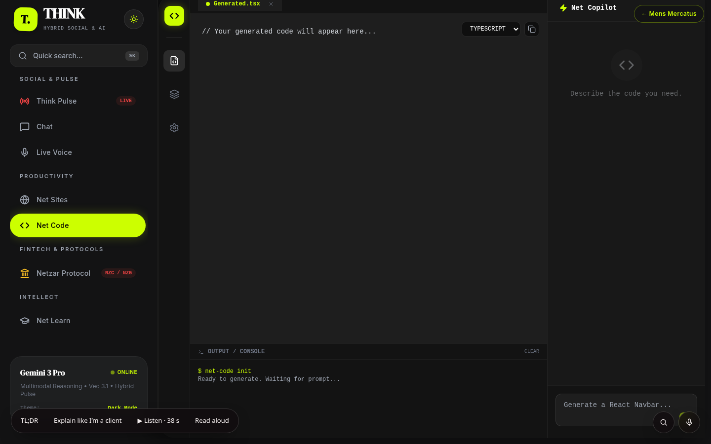

# THINK

**Status:** LIVE, with per-IP caps · **Live:** https://mensmercatus.online/think/ · **Case study:** https://mensmercatus.online/case-studies/assist/

## What it does
THINK is a multimodal AI workspace in one React app: chat, image, live voice, Net Sites, Net Code and a learning path, powered by Gemini. The visitor chooses the path; THINK answers, drafts and explains, and never takes an action on anyone's behalf.

## How it's built
- React 19 + Vite + TypeScript front end.
- Every model call goes through a same-origin proxy to a C# / ASP.NET Core 8 minimal API, so the browser never holds the API key.
- The API runs as a systemd service on an Ubuntu VPS behind nginx; the static site sits behind Cloudflare.
- The API uses an OpenAI-compatible chat-completions client, so the model provider can change in config without a UI rewrite.
- Live voice runs over WebSocket.
- Exponential backoff on HTTP 429 and 5xx; daily per-IP caps on chat, image, video and live voice.
- If the health check fails, the screen says it is in demo mode instead of pretending to be live.

## Limits
- A portfolio workspace with caps, not an unlimited production assistant. Hitting a cap is the control working, not a bug.
- Feed content inside THINK is product demo content, not a claim about real users, partners or compliance.
- Unit-test counts are not published; the public checks are the fallback label, the proxy boundary and the retry policy.

## Screenshots
| Chat | Live voice |
|---|---|
|  |  |
| **Net Sites** | **Net Code** |
|  |  |
